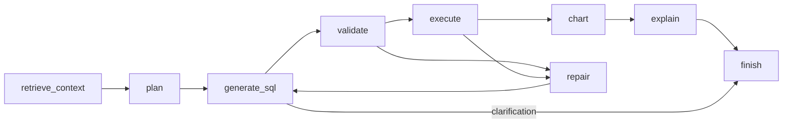

> Historical document retained for context. It may describe earlier behavior or unimplemented plans. Current behavior and verified limits are documented in [README](README.md), [operations](docs/OPERATIONS.md) and the Phase 9 final review. This file is not a current feature claim.

# InsightIQ architecture — through Phase 6 AutoML

React/TypeScript/Vite/Tailwind and accessible Radix/shadcn-style controls render the data workspace, Analyst and knowledge editor. Recharts loads on demand. Typed fetch contracts match FastAPI/Pydantic contracts. SQLite catalog/run/knowledge metadata use SQLAlchemy; PostgreSQL remains an unverified upgrade path requiring a driver, migrations and compatibility tests. One local user, one API worker is supported.

## Data and knowledge boundary

CSV uploads pass the existing bounded UTF-8 parser into a UUID-named DuckDB `records` table. Bound parameters preserve values; identifiers are quoted; filenames remain metadata. Limits remain 5 MiB, 20,000 rows and 100 columns. Raw cells remain VARCHAR, missing cells NULL. Metadata synchronizes after import; errors compensate catalog/file creation. Crash recovery between file rename/catalog commit remains future work. Fixed schema/profile/preview queries use read-only connections with external access and extensions disabled.

A server-owned `workspace.json` identity plus the authorized dataset UUID determines an opaque namespace. `knowledge_state` stores descriptions/metrics/schema revision; `knowledge_examples` stores execution-verified question/SQL provenance and digest, never result rows. Index fingerprints cover physical schema/profile, database SHA-256 revision, confirmed mapping, definitions, examples and embedding model identity. Schema changes are re-read, refresh the catalog, invalidate stale example signatures and produce a new snapshot. Mappings are per run, with separate index snapshots. Dataset deletion synchronizes data/catalog/knowledge/index cleanup and blocks active runs. Lifecycle locks serialize run admission, deletion and example replay.

Sentence-transformers all-MiniLM-L6-v2 runs locally on CPU, local-files-only, remote code disabled, safetensors required, normalized vectors. Provisioning explicitly downloads a pinned public model revision and records weight SHA-256. There are no automatic runtime downloads or fake vectors. Missing assets expose a degraded retrieval result; actual-schema SQL analysis remains available. Production and tests can inject embedding/model interfaces; controlled implementations live only in tests and are excluded from the image.

FAISS IndexFlatIP uses cosine similarity, portable CPU kernels (avoiding Python 3.12 ARM detection incompatibility), ≤256 documents of ≤3,000 characters, ≤2,048 embedding dimensions, top-k ≤10. Atomic index/JSON manifest snapshots are hash checked and bounded before loading; no pickle is used. Corrupt/missing/stale snapshots rebuild. Three snapshots per namespace are retained. Documents include source/provenance, current mapping, descriptions, user-defined metric SQL, conservative naming-based relationship candidates and replay-verified examples. Relationships are explicitly unconfirmed; examples are execution verified, not semantically certified. No unrelated dataset schema or cross-workspace index is searched. There is no authentication layer; namespace separation is not multi-tenant authorization.

## Bounded LangGraph workflow

`workflow.py` compiles/invokes a real StateGraph with typed state and recursion limit 32. Planning is a concise deterministic constraint summary, not the model's internal reasoning. SQL guard failures and generic recoverable query execution errors route to repair, with at most **three SQL generations**. A repeated previously failed normalized query stops before another validation/execution. Repair supplies bounded previous SQL/error context as untrusted data and always returns through validation and the worker. Correct empty results proceed to chart/explain; provider/auth errors, resource limits, deadlines, sandbox failure and cancellation do not trigger blind retries. Each generation call has a hard 30-second deadline, 5-second connect timeout, 64 KiB response cap and strict structured output. A successful SQL query may make one additional model request to select computed fact IDs: maximum four model calls per run.

All question, retrieved text, filenames, examples and descriptions are untrusted reference data. System instructions limit generation to the selected relation and explicit types. The guard/worker enforce the boundary independently of model compliance. LangSmith tracing is explicitly disabled around graph invocation; no cloud traces or chain-of-thought are persisted.

## Preserved SQL execution boundary

sqlglot allows one explicitly supported SELECT/set query, actual columns, selected `data`, non-recursive CTEs and self joins. AST nodes/functions fail closed. Table functions, external files/network, system schemas, unknown functions, arbitrary tables, DDL/DML/multiple statements and implicit text numeric operations/comparisons are rejected. SQL is never accepted from the browser as executable input. User metric SQL passes the same guard as contextual reference only.

Each execution launches fresh `python -I` with a scrubbed environment, receives only the selected database path/SQL/mapping, re-reads physical schema and independently validates. The temporary typed `data` view applies confirmed TRY_CAST conversions while raw data stays unchanged. BIGINT mapping accepts integer syntax only, DOUBLE excludes nonfinite values; suggestions remain unconfirmed until user action. DATE inference preserves timestamps by requiring date-only ISO input. Missing/failed counts describe full input before filters/joins. Native TRY_CAST remains supported, with direct-column conversion diagnostics; complex cast lineage is not inferred.

DuckDB is read-only, external access/extension loading disabled, configuration locked, memory 128 MiB, one thread, zero temp spill. Linux seccomp denies file opens/network/mutations/exec/ptrace/io_uring after trusted initialization with TSYNC; macOS Seatbelt denies network/filesystem access except selected database reads. Unsupported sandbox initialization fails closed. CPU soft/hard limits are 3/4 seconds; file/core limits zero; Linux address-space limit 2 GiB. Parent hard wall deadline is five seconds, with process-group kill/reap on cancellation/timeout. The parent API container has 2 GiB / one CPU to accommodate embeddings. There is no claim of formal native-code/kernel isolation or exhaustive memory-exhaustion testing.

Complete results over 1,000 rows, 100 columns or 1 MiB encoded rows are rejected, without partial success or implicit LIMIT. Large integers/decimals/dates/nonfinite values preserve string representations when needed. CSV formula neutralization is disclosed; API values are unchanged.

## Charts and grounded evidence

`charts.py` validates strict ChartSpec against actual result types/rows. Column indexes avoid duplicate-name ambiguity. Bar/donut require unique categorical labels and ≤20/8 points; donuts require nonnegative values/positive total. Lines require unique actual DATE/TIMESTAMP values, sort chronologically and use numeric epoch spacing. Scatter requires two numeric columns. One-row finite KPI and exact table/no-chart fallback are supported. Null/nonfinite/unsafe numeric pairs are omitted with counts; cardinality is rejected, never silently sampled/aggregated. Browser switches call server validation. Bar/line axes include zero, no smoothing/causal overlays.

`evidence.py` computes Decimal statistics over returned rows: up to eight numeric columns, total/mean/min/max, top three, shares only with nonnegative positive totals; period change/trend only for complete finite unique regular observed periods (including consecutive first-of-month periods). Percent change requires a positive previous value. Facts contain IDs, value, canonical sentence, result SHA-256, source column/row indexes, formula and returned-row scope. Displayed fractional calculations are rounded to 12 significant digits; source results remain unchanged.

Up to 80 bounded fact summaries go to the LLM, including result-derived values/labels; no full result table or repeated source-index lists. Output can only select known unique fact IDs (1–6). The server renders exact canonical sentences and rejects arbitrary prose/unknown IDs. Invalid/unavailable narrative selection yields visible computed-only fallback without converting successful SQL to failure. This grounds arithmetic, not SQL/business semantic correctness. No causal/forecast inference is generated.

## Events, persistence and privacy

`analyst_runs` JSON payload is additive/backward compatible: statuses, question, mapping, SQL, query description, timings/available usage/cost, result metadata, retrieval provenance, chart spec and up to 96 events with timestamp/step/status/attempt/≤500-character summary. No raw result rows, computed evidence payloads or secrets are stored in analyst_runs. Phase 4 explicitly saved snapshots are described below. Events contain concise outcomes, not hidden reasoning. Unknown usage/cost totals remain null if any request lacks them; model/query latency accumulates across attempts. Logs contain sanitized metrics, not prompts/row contents/upstream bodies/keys.

Results plus analysis stay in an in-memory cache, max 20 runs and 10-minute TTL, lost on restart. Charts/evidence/results return 410 after expiry. History/event/retrieval metadata remains inspectable. Startup marks unfinished runs failed. Two analyst/replay execution slots bound concurrency; model/embedding operations observe cancellation after the current bounded operation returns, while active SQL is killed promptly. One API process is supported.

SSE `/events` replays persisted monotonically numbered events using `Last-Event-ID` or `after`, sends heartbeat every 10 seconds, closes after terminal completion and caps subscribers at 16. Invalid/out-of-range cursors return clear errors. Disconnect/cancellation of the stream releases the subscription; accepted jobs continue. React uses native EventSource reconnect with a visible connection status and retained status polling fallback. Nginx buffering/cache is disabled for API streaming. All API responses use no-store.

## Remaining phases

Phases 1–4 are implemented as described below. The requested Phase 5 now covers evaluation/reliability/agent improvement (below); the earlier release-hardening proposal remains deferred: authentication/authorization, quotas/retention, PostgreSQL verification, distributed state, full dependency/security/accessibility/cross-browser review and deployment. No public deployment was introduced. A bounded real Groq smoke and a two-question evaluation exist; general live-model semantic quality is not established.

## Phase 4 — persisted decision workspaces

`persistence.py` applies additive versioned migrations at startup. `schema_migrations` records v1 (existing catalog/run/knowledge tables) and v2 (`dashboards`, `saved_charts`, `benchmark_installs`, `evaluation_jobs`). Migrations use SQLAlchemy DDL, check existence and preserve user rows; JSON payloads allow additive metadata evolution. No destructive migration or Git initialization occurs. Back up DATA_DIR/volume before upgrading. PostgreSQL remains an untested driver/migration path, not a verified deployment.

A dashboard stores title/description, optimistic revision, ordered widget references, 12-column width / 2–8 height, dashboard/per-widget filter contracts and note cards. Up to 50 dashboards, 24 widgets each and 100 library charts are allowed. Mutations use a service lock and expected revision; stale edits return 409. Desktop supports native drag handles and keyboard move buttons; mobile collapses to one column. Dashboard deletion keeps library charts; charts cannot be removed while referenced. Widgets share library snapshot identity, so a library refresh updates every referencing widget.

Saved charts are the intentional, explicit exception to ephemeral Analyst rows. Saving requires consent and a successful cached run. Persist only that accepted result (≤1,000 rows / 1 MiB), source dataset/question/executed SQL/type mapping/schema signature, validated ChartSpec, refresh policy/time/error and bounded canonical narrative summary. Documents are capped at 2 MiB. No automatic user dataset snapshots or fabricated previews exist. Deleting a source dataset does not silently delete opted-in snapshots; the knowledge UI discloses separate library deletion. A retained snapshot remains visibly historical; refresh requires the authorized current dataset.

Fixed snapshots cannot refresh. Manual refresh holds lifecycle/shared execution slots, checks schema shape, validates saved SQL and uses the same isolated worker. Schema drift/errors retain the last good snapshot and persist a refresh error. Data changes with unchanged schema can refresh. New incompatible chart shapes fall back to an exact table, not stale visual values. No refresh contacts the LLM.

Typed category/date/numeric filters operate on complete **query-output rows**, with explicit scope. They never rewrite SQL or imply pre-aggregation filtering. Category membership and finite Decimal/date bounds compare actual typed result columns. Date-only upper bounds include that calendar day. Missing/ambiguous/incompatible columns are marked not applicable. Nulls fail active predicates. Dashboard and per-widget filters combine; reset restores original output. Existing aggregate values are unchanged; evidence is recomputed over the selected output rows. For source-row metric filtering, issue an explicit Analyst question instead.

`contracts.py` and Pydantic request models document dashboard/chart/evaluation responses and strict mutation fields. CSV uses exact filtered rows and existing formula protection. PDF is generated locally with ReportLab from actual persisted/filtered rows, deterministic vector charts, computed facts, timestamp, dataset/SQL provenance, refresh/filter scope, narrative source and limitations. Reports cap 24 widgets, 80 PDF pages, two concurrent PDF generators and 8 MiB per PDF/structured dashboard report; table previews explicitly limit rows/columns/cell text and disclose it. Full rows/metadata remain in CSV/JSON. PNG comes from the actual rendered Recharts SVG through a bounded browser canvas; no external asset service or model is involved.

## Phase 4 — evaluation isolation and budget

The immutable `retail-v1` controlled CSV and 45 authored case contracts live outside RAG in `backend/benchmarks` / `benchmark.py`. Expected values are authored independently, then reference SQL is verified through guard/worker against the explicit installed dataset. Registry UI reports exact verified/pending counts. Five ambiguous/unsupported cases expect meaningful clarification; 40 SQL cases cover selection, aggregation, grouping, ordering, dates, arithmetic, explicit metrics, CTEs and authorized self joins. Separate physical-table requests expect abstention: cross-dataset authorization was not broadened. The benchmark must be explicitly installed, content-fingerprint checked and reference-verified; arbitrary uploads do not become compatible. Custom benchmark knowledge/examples block paid evaluation to avoid gold contamination. Gold SQL, expected outputs and correctness labels are never generation context or RAG documents.

`EvaluationService` runs one job/case at a time, using internal Analyst submission and the existing graph. Baseline disables retrieval and repair; RAG uses retrieval with one attempt; agentic allows three attempts. Narrative model selection is disabled during scoring (computed evidence still runs), avoiding unnecessary paid calls. Each case stores actual predicted SQL/run events/usage/results, gold result, typed comparison and configuration. `activity_kind=evaluation` excludes it from normal run analytics.

Comparison requires exact output aliases and logical type families. Integer contracts compare exactly; other numeric families compare with absolute 1e-9 / relative 1e-6 tolerance. NULLs, duplicates, row counts and required order remain significant. Unordered results use bounded maximum matching (≤100 rows), not set equality. Appropriate abstention is distinct from execution failure. Accuracy is correct / completed selected cases, with separate SQL validity per generation attempt, execution success and result accuracy. It is not automatically a score over all 45 cases. Configuration history includes version/selected IDs/model; compare matching selections.

Unknown error causes remain unknown. Automatic guard/reference and SQL-structure differences are labeled diagnostic signals only. A separate post-run reviewer contract records local-user rationale and independent cause labels. Wrong-join/filter/aggregation and hallucinated-column/table rates use only reviewed cases, with the reviewed denominator shown. This is human annotation, not formal semantic certification or automatic causal diagnosis.

Paid-call admission requires explicit confirmation and documented configured rates. One job, ≤10 selected questions, ≤30 generation calls, ≤1,600 output tokens/call, ≤500,000 total reserved tokens, ≤$5 configured spend and a 10-minute wall deadline are enforced. Before each call the wrapper reserves a conservative serialized-byte token upper bound plus schema/protocol allowance and the output cap. Reservations must fit token and configured-dollar ceilings; otherwise stop before calling. Reserves are never mistaken for actual billed usage. Unknown reported usage/cost stays null. These are application reservations at configured prices, not provider billing reconciliation or a guarantee against provider price changes. Every query still consumes existing execution slots. Cancellation sets both job and active run signals; provider calls stop at their existing deadline/cancellation boundary. Restart marks interrupted jobs failed. Up to 100 evaluation records are retained; terminal records can be explicitly deleted.

## Offline evaluation maintenance

`POST /api/evaluations/offline` enters a separate admission/worker path in the existing `EvaluationService`. It shares durable jobs, cancellation, job/query slots, dataset fingerprint verification, `validate_sql`, `execute_isolated` and `equivalent` with paid evaluation. Dispatch occurs before provider access or budget-provider construction. No call to Analyst submission, LangGraph, knowledge settings/retrieval or embeddings occurs. Only the knowledge lifecycle lock is reused while executing SQL. No new table or migration is needed; response contracts are additive (`mode`, nullable case run/correctness, provenance/status/counts).

The worker resolves source predictions from terminal paid jobs by exact benchmark version, question ID/text, dataset identity/content fingerprint and analysis type mapping; it checks original durable Analyst run metadata and SQL against the saved source snapshot. References and offline jobs cannot be prediction sources. A source-less case remains missing/unscored. Matching SQL is guarded and re-executed through the unchanged read-only resource-limited sandbox. Reference SQL executes separately and must still satisfy authored expected values before prediction scoring. The same order/null/duplicate/type/numeric comparison applies. Saved genuine clarifications support authored abstention cases.

Offline metrics count only non-null prediction judgments in their accuracy denominator. Missing predictions and reference failures remain separate; execution/validation failures count as incorrect. Zero eligible judgments means null accuracy. New calls/tokens/cost are exactly zero; historical source events/usage retain their original identity. Paid rates/consent/reservations remain on the existing paid endpoint. Benchmark gold material stays outside the retrieval index.

The frontend defaults to offline mode and renders a separate report table. `ExecutionTracesPage` now owns recorded history/inspection; the former shared Analyst/Execution traces route branch was split. Every sidebar mapping is regression tested. `numericAxis` formats only Recharts Y ticks and label width, preserving all SQL, raw points, domains and tooltips.

## Phase 4 — observability and remaining boundary

Run analytics aggregates the latest 10,000 persisted dataset-matching records with date/model/status/search filters. It reports actual run outcomes, rejected SQL events, attempts, latency percentiles, retrieval timing when recorded, known usage/cost coverage, errors and trace history. Missing latency/cost is unknown, never synthetic zero. User activity success is not benchmark correctness. Overview uses these same real records/catalog/dashboard counts.

The live configured Groq `openai/gpt-oss-120b` smoke passed one controlled sum, guard/worker, real RAG and grounded narrative. It is not a full live benchmark-quality claim. Automated regression/evaluation uses explicit test-only providers; production has no mock mode. The app remains local, single-user, one API worker, localhost-bound. No release-hardening authentication, authorization, distributed ownership, complete dependency/accessibility audit or public deployment was introduced.

## Phase 5 — evaluation reliability and reproducibility

The actual historical q05 count returned 8 correctly but failed the strict alias contract (`order_record_count` vs `orders`); q06 SUM returned 1000 and passed. Strict accuracy remains 1/2, not a 45-question measurement. See docs/PHASE5_DIAGNOSTIC_REPORT.md (removed) and the stored-source/offline-replay evidence JSON files for full questions, SQL, outputs, scoped retrieval and traces. No new model predictions or quality improvement are claimed.

`prompts.py` contains generic, benchmark-free SQL grounding instructions and prompt/workflow versions plus a SHA-256. Confirmed schema identity/types and conversion counts remain authoritative. Guidance distinguishes record/non-null/distinct counts, total vs average/ratio grain, duplicate and NULL preservation, date boundaries, mapped vs raw numeric text, grouping/order and genuine ambiguity. No benchmark ID, expected alias/value or reference SQL is added to generation. Analyst metadata now records prompt version/hash, workflow version and up to three structured generation outcomes with context fingerprints and per-attempt validation/execution/error categories. Historical missing provenance stays null/unknown; the original provider request/default sampling cannot be retroactively reconstructed.

LangGraph topology is preserved. Safe guard/worker feedback includes an error code and remaining attempts. Normalized repeated failed SQL stops before reexecution; distinct failed candidates still cap at three generations. Only recoverable validation/execution errors can repair. Successful SQL, clarification, resource/sandbox/provider errors, cancellation, timeouts and exhausted reservations do not create a semantic-verification loop or additional model calls. The original read-only guard/worker and paid consent/reservation deadlines are unchanged.

`evaluation_reporting.py` is an evaluation-only projection over the existing comparator. It computes optional positional typed-value diagnostics on copied result metadata while preserving strict aliases, column positions/types, order, NULLs, duplicates, tolerance and original correctness. Alias-only agreement is not semantic certification or an alternate accuracy score. `present_job` exposes diagnostics and denominator-rich metrics for both new and legacy records without rewriting stored predictions, reference contracts or historical outcomes. New rows retain order sensitivity explicitly; legacy retail-v1 rows obtain it from the unchanged registry.

Metrics v2 separates validated SQL candidates, successful execution over answerable evaluated cases, strict correctness over scored predictions, answerable accuracy, and correct authored abstention, each with numerator/denominator/unit. Latency, usage and cost report observed coverage. Independently reviewed failure rates remain unknown with no reviewed cases. Offline rates describe new local replay validation/execution; historical model effort is confined to source details. Paid validity now uses observed validation outcomes rather than a generation count that also includes clarifications/errors. JSON/CSV expose alias diagnostics; SQL/results/scores are unchanged.

Both report modes reuse shared result filtering and per-case diagnostics (SQL/reference, expected/actual, difficulty/status/reason, model/pipeline/dataset/fingerprint, attempt history, retrieval, trace and latency/tokens/estimated cost). Selected cases without records stay unevaluated. Reference SQL is visible in evaluation result details, not the question-selection controls. Evaluation activity cannot be promoted to approved retrieval examples, preventing feedback contamination; normal user examples still require their existing execution verification.

## Phase 6 — local AutoML & predictive intelligence

`AutoMLService` reuses registered DuckDB datasets, the fixed read-only connector, lifecycle locks and DocumentStore, with additive migration v3 (`ml_experiments`, `ml_models`, `ml_predictions`). AutoML is independent of the provider/RAG/LangGraph path. It never executes generated Python or broadens SQL access. Models train only on explicit task/feature/type/availability-confirmed requests in a one-thread resource-bounded child process. Dataset content/schema fingerprints, split row indices/group hashes, seed, configuration, versions and measured metrics persist with registry artifacts. See PHASE6 architecture for exact CPU/RSS/wall/data/encoding/artifact limits and leakage boundaries.

Implemented five regression and four classification candidates use train-only Pipeline/ColumnTransformer imputation/scaling/encoding and validation selection; only the selected model receives an untouched test score. Equivalent numerical/calendar feature rows group across splits; stratified group folds require adequate class coverage. K-Means/RFM/PCA and IsolationForest expose descriptive diagnostics, without fraud/ground-truth accuracy claims. Forecasting uses explicit time aggregation/fill policy, naive/seasonal/lag baselines and chronological selection/backtesting with a final holdout. No intervals are invented.

Registry artifacts are application-generated UUID-owned joblib files, hash/version checked before loading. Only completed source experiments publish/serve models; failed/interrupted sources cannot expose partial registrations. Single/batch predictions validate saved schema and source fingerprints and run in bounded secret-free workers; paged persistent results export through existing formula-safe CSV handling. Models and predictive charts live in AutoML Studio's results dashboard, preserving the legacy SQL snapshot-dashboard contract.

The React page has task-specific configuration, real readiness, progress/cancel/error states, measured comparisons/charts, registry and prediction/history. Startup never trains, predicts or invokes a provider. The final environment/test/demo status, including the external Docker pause, is documented in Phase 6 results. Deployment hardening/authentication/PostgreSQL remain outside this scope.

## Module 1 dataset editing — 2026-11-06

`dataset_editor.py` adds private `_editor_ids(ordinal,id)` and `_editor_state(payload,original)` tables to each dataset DuckDB using an additive transaction. `records` retains exactly the uploaded VARCHAR columns; the SQL guard and query-worker relation are unchanged. UUIDs are stored independently of user columns and survive row replacement, sorting and paging. All edits validate before mutation, then replace records/ID order and update the revision payload in one DuckDB transaction. Deletion/reinsertion is bounded by the existing 20,000-row limit. Rollback covers injected write failures. Original upload bytes are immutable in `_editor_state.original`.

The knowledge lifecycle and Analyst admission locks serialize edits and concurrent version checks. Active durable Analyst jobs or AutoML work reject saves. SQLite catalog metadata is a derived projection, refreshed after commit and recovered at startup from the authoritative DuckDB. This deliberately avoids claiming a distributed transaction across DuckDB and SQLite: a post-commit projection failure returns an explicit saved-version recovery message. Every API read carries no-store. Profiles recompute from records; knowledge content fingerprints change, excluding outdated example provenance and selecting rebuilt lazy indexes. Historical result caches, run history and chart snapshots remain intact. AutoML's existing logical content fingerprint detects modified source data without changing its model contracts.

Retention keeps original upload bytes, latest records, latest validation mapping and 100 bounded revision audit entries. No intermediate row snapshots are retained. Older imports have no retained upload, so initialization reconstructs their original CSV from existing records. Export takes a revision-consistent bounded snapshot and streams CSV chunks; it preserves whole-dataset ordering and exact text with standard UTF-8 quoting. Empty text and NULL are distinct in DuckDB/API, but both export as empty CSV fields. Authentication/distributed workers are unchanged and outside this enhancement.

The 2026-11-07 cell-edit improvement reuses these APIs without changing the backend mutation or SQL security contracts. Data preview renders one UUID-backed table instead of a separate read-only preview beneath an editing panel. `EditableDatasetCell` opens a single inline input; `DatasetEditor` owns the pending input, net cell changes, original values, bounded operation history and confirmed mappings. Input tokens prevent blur from committing a different cell after keyboard navigation. Enter, Tab and blur commit cell operations; Escape discards the current buffer. Save serializes only changed columns under existing row UUIDs; edits never populate `additions`. Successful saves explicitly reload rows/version, recompute the profile and refresh catalog metadata; cancelled/failed requests retain the appropriate draft state. Schema view hides rather than unmounts the editor so tab switching preserves drafts. Out-of-order page responses are ignored. Existing AutoML source fingerprints reject old-model inference after source edits; models, previous predictions and run snapshots remain immutable unless separately managed through their existing APIs.

## Monetary presentation boundary

Confirmed column/metric currency metadata lives in existing dataset knowledge settings. Conservative sqlglot lineage adds optional per-column units to accepted results and snapshots; unsupported lineage abstains. Explicit mixed-unit arithmetic/aggregation requires clarification before execution. Existing SQL validation, isolated worker and immutable source data remain unchanged. Legacy result-column contracts omit absent metadata; old snapshots remain readable. Benchmark authorization checks the expanded empty knowledge model, so financial definitions cannot leak into controlled evaluations.

`currency.py` owns validated metadata, a fixed-endpoint opt-in daily-rate adapter, bounded one-hour pair/date caching, Decimal conversion and report/export transformations. The browser shares exact decimal display transformation by run/widget across tables, KPIs and charts; formatting uses Intl. Raw SQL rows remain separate. Converted CSV appends columns; converted report generation deep-copies snapshots, labels quote provenance, and retains raw rows in JSON. Rate requests transmit only currency codes/date, never dataset rows. Full contracts and operational limits: [currency architecture](docs/CURRENCY.md).

## Workspace presentation refinement

`frontend/src/workspace.css` supplies a shared token and presentation layer over the existing domain styles, imported after `index.css`. Existing React components and API clients remain in place. The grouped sidebar supports a browser-local persistent collapse preference and a mobile drawer with keyboard focus management/inert closed content. Native disclosures retain advanced form state; dataset tabs keep their existing mounted-editor behavior. The Analyst composer precedes results and technical inspectors. Currency display uses the same original-value store; KPI grouping changes presentation only. A latency SVG derives every point from actual recorded runs. No backend, query guard, agent, dataset or model-service boundary changes. UI verification/artifacts: refinement report.
