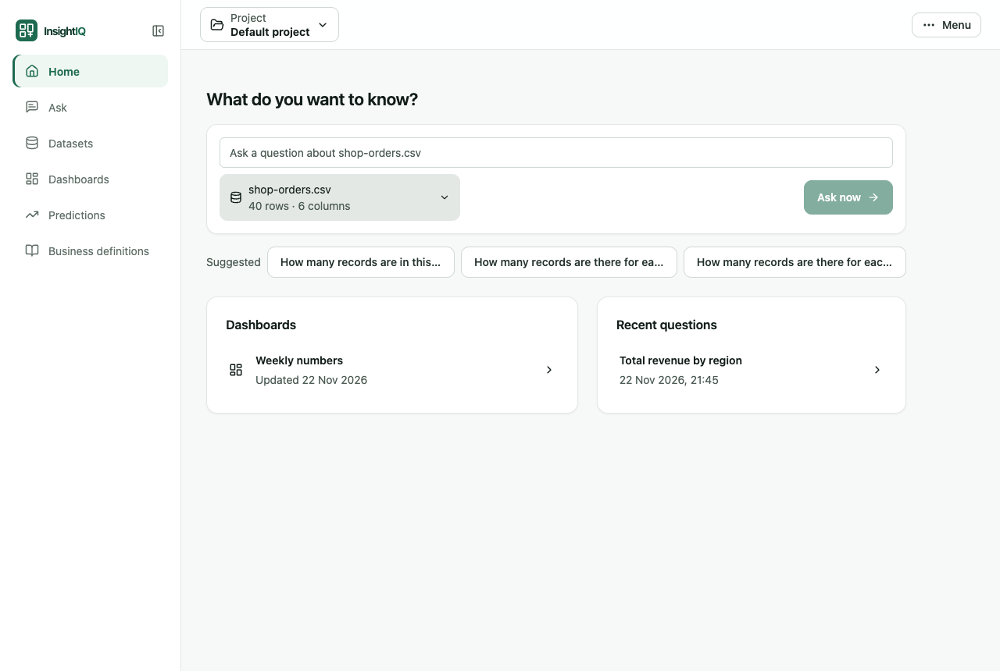
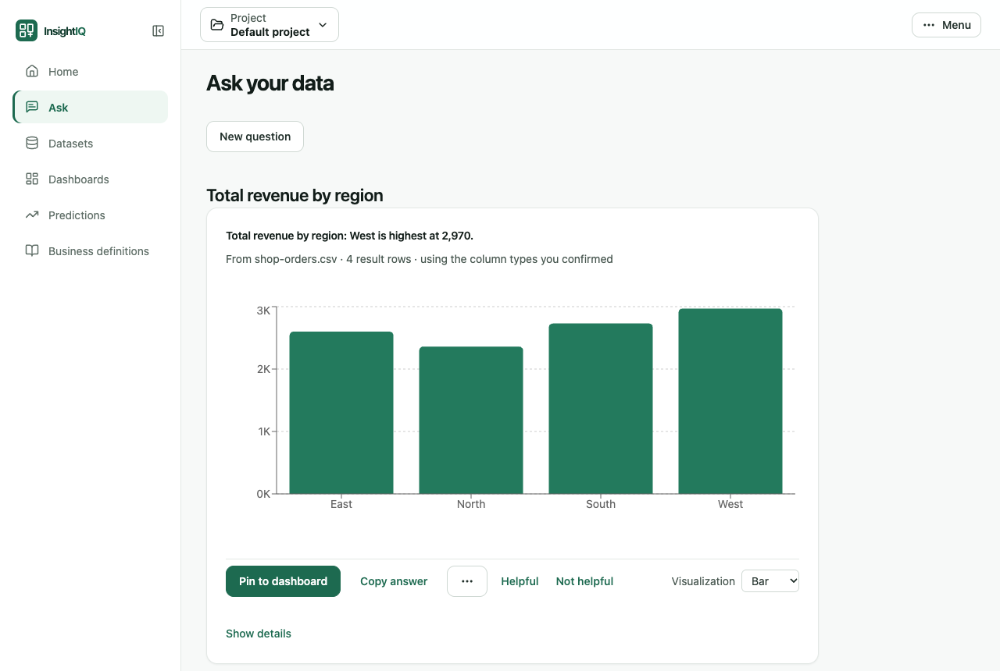
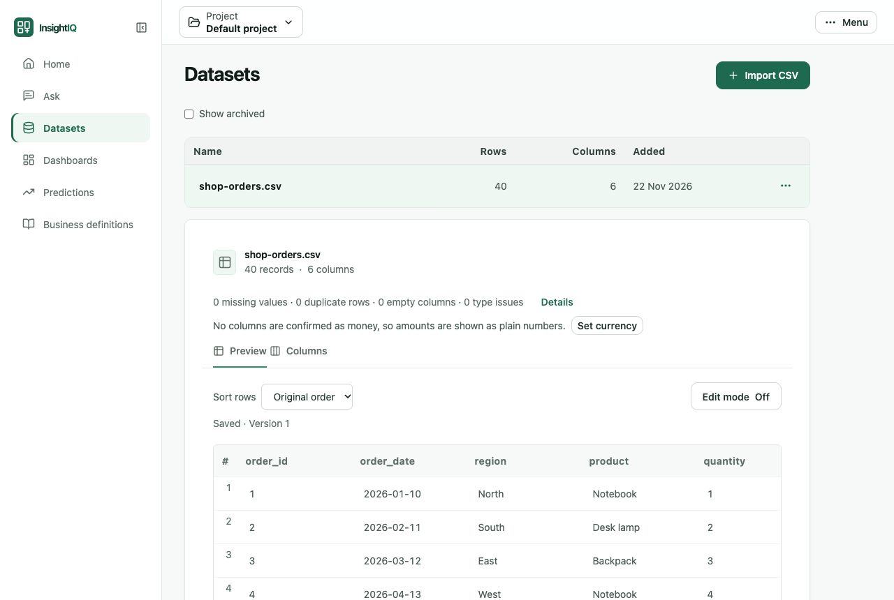
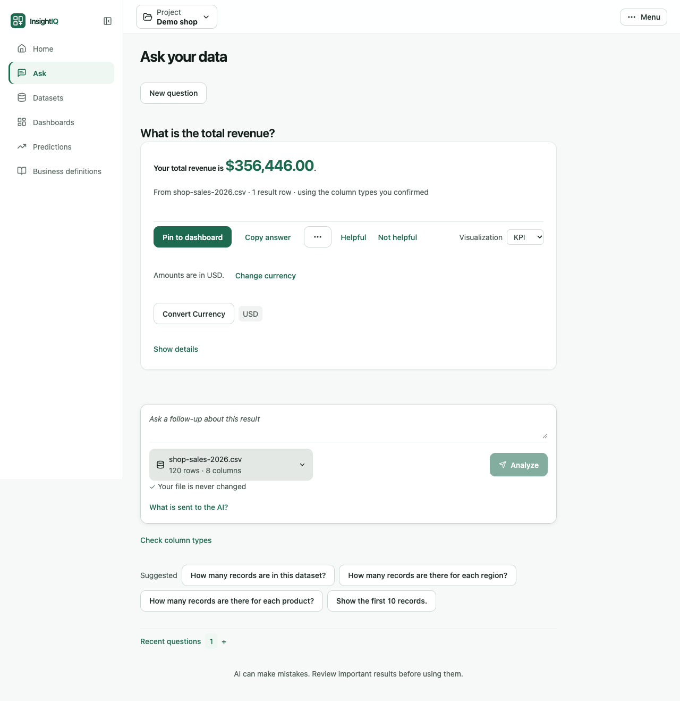
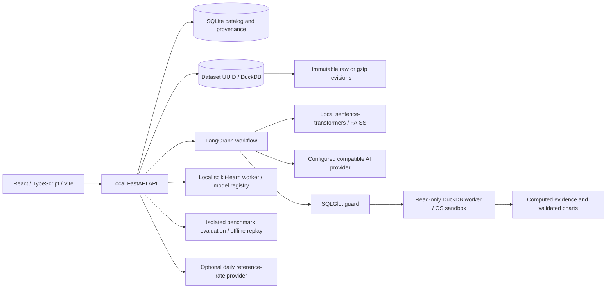

<p align="center"></p>

# InsightIQ

**InsightIQ lets a non-technical business owner upload a CSV, ask questions about it in plain English, and get answers they can check.** It runs on your own computer, for one person, and shows only the current project. A question is turned into a read-only database query that you can inspect; the result is shown as one plain sentence, a chart or a table, and can be pinned to a dashboard or exported as a PDF.

| Home | Ask | Datasets |
|---|---|---|
|  |  |  |

*The screenshots use a small fictional shop file.*

## Quick start (one command)

You need **Python 3.9 or newer** and **Node 22 or newer** (Docker is optional, see below).

```sh
git clone <your copy of this repository> insightiq && cd insightiq
sh scripts/demo.sh
```

The first run installs the packages it needs (several minutes and a few GB, because it includes local machine-learning libraries). It then starts the app on a **fresh, empty data folder** (never your real workspace), prints the address, and opens your browser. Stop it with `sh scripts/demo.sh stop`. On Windows use `scripts\demo.ps1` (written but not tested on Windows).

To ask **new** questions the app needs an AI provider: copy `.env.example` to `.env` and fill in `LLM_API_KEY`, `LLM_MODEL` and `LLM_BASE_URL`. The demo script reads only those settings from `.env`; it never prints them. Without them, uploading, the column check, browsing data, predictions and saved dashboards all work; only asking a new question does not.

Prefer a click-through without any AI? [docs/DEMO_WALKTHROUGH.md](docs/DEMO_WALKTHROUGH.md) uses a repeatable stand-in. Trying it on a real file: [docs/DEMO_REAL_DATASET.md](docs/DEMO_REAL_DATASET.md). How it differs from a general chat assistant, without any claim of better accuracy: [docs/COMPARISON.md](docs/COMPARISON.md).

## Status: login is on hold

A login (roles, people, one-time links, two-step sign-in for owners, a security log) is built and tested, but it is **off by default** (`AUTH_MODE=off`): the app starts with no login screen and works as described below. When it is turned on it requires a login, users have roles, and owners use two-step sign-in. It has **not been independently reviewed** and is **not ready to host any customer's data**. A hosted package (stage A5, folder `deploy/`) is built but **not reviewed by the owner**; real certificates and a real server were not exercised. A6 to A8 (AI settings, isolation test suite, independent review) are not started, and terms need a lawyer's review before any hosting. Details: `docs/ACCOUNTS_PLAN.md`.

## Who it is for

1. **Business owners and managers** (retail, shops, small companies) who keep sales, orders, customers and costs in CSV or Excel exports and do not write SQL. This is the primary user: Home, Ask, Datasets, Dashboards, Predictions and Business definitions are built for them.
2. **Analysts**, who can turn on technical details to see the SQL and exact values, and who write the business definitions.
3. **Learners**, who get plain-language predictions with honestly measured results next to a "simple guess" baseline.
4. **Operators and developers**, who use the Admin area (accuracy check, performance, traces, change history, backup info), hidden until switched on.

## What you can do

| Page | What it does | Desktop / Mobile |
|---|---|---|
| **Home** | "What do you want to know?", suggested questions, your dashboards and recent answers; a short setup guide that disappears after your first answer. | [1280](docs/screenshots/home-1280.png) / [390](docs/screenshots/home-390.png) |
| **Ask** | Ask a question in plain English; one answer sentence, one chart, a collapsed "Show details" (data, SQL if enabled, how it was calculated), Pin to dashboard, follow-ups. Column types are confirmed once before the first question. | [1280](docs/screenshots/ask-1280.png) / [390](docs/screenshots/ask-390.png) |
| **Datasets** | A Files panel lists the project's datasets (import, new project, refresh); pick one to see its table. Import a CSV, see it in a table, check its health (counts only), edit cells with undo and version history, rename, archive, delete (guarded), mark sample data. | [1280](docs/screenshots/datasets-1280.png) / [390](docs/screenshots/datasets-390.png) |
| **Dashboards** | Pinned answers in a tidy grid with an "Updated" date, display currency, refresh, and a PDF whose last pages show how every number was calculated. | [1280](docs/screenshots/dashboards-1280.png) / [390](docs/screenshots/dashboards-390.png) |
| **Predictions** | Three plain steps: choose what to predict, check and train, read the measured results and predict. Warns when a column may give away the answer. Runs locally; no AI calls. | [1280](docs/screenshots/predictions-1280.png) / [390](docs/screenshots/predictions-390.png) |
| **Business definitions** | Tell the app what your columns and key metrics mean. Units (money, percentage) are shown only after you confirm them. AI drafts are suggestions you approve one by one. | [1280](docs/screenshots/business-definitions-1280.png) / [390](docs/screenshots/business-definitions-390.png) |
| **Admin area** (Menu, Show admin tools) | Accuracy check, Performance and errors, Execution traces, Dataset change history, Backup info. Each page says what it is for and carries the banner *"Admin tools: not protected by a login. Anyone using this computer can open them."* | [Accuracy check, before any run](docs/stage5/after/accuracy-check-empty-1280.png) · [Change history](docs/screenshots/admin-change-history-1280.png) · [Backup info](docs/screenshots/admin-backup-info-1280.png) |



A **project** is a workspace for one business: every page shows only the current project's datasets, questions, dashboards, models and definitions. Projects organise your work; they do **not** protect it (see Honest limits).

**Try it in five minutes** on throwaway data with the repeatable stand-in AI: [docs/DEMO_WALKTHROUGH.md](docs/DEMO_WALKTHROUGH.md). The longer tour is [docs/DEMO_FULL_TOUR.md](docs/DEMO_FULL_TOUR.md).

## Architecture



CSV cells stay in their original string form; confirmed analysis types are applied through a temporary SQL view. SQL executes in a separate process with a read-only database, disabled external access/extensions, an independent guard and OS restrictions. The browser never receives provider credentials. See [security](docs/SECURITY_AND_PRIVACY.md) for the actual boundaries and remaining limitations.

## Run with Docker

Requirements: Docker with Compose. From the repository root:

```sh
cp .env.example .env
# Edit .env: API base URL, model and key for your compatible provider.
docker compose build
docker compose up -d
```

Open **http://localhost:8080**. API access is bound to **127.0.0.1:8000**. Compose retains the named `insightiq-data` volume. Do not use `docker compose down -v` to stop the app: that removes the workspace volume.

For local retrieval, explicitly provision the pinned public embedding assets:

```sh
docker compose run --rm api python scripts/provision_embeddings.py \
  --revision 1110a243fdf4706b3f48f1d95db1a4f5529b4d41
```

This is an intentional model-asset download. Runtime retrieval does not silently download assets; without them it reports unavailable and analysis can use the actual schema. Provisioning is not an AI question request.

## Run locally

The existing tested environment supports Python 3.9–3.12; the container uses Python 3.12. Frontend tooling requires Node 22.12+ or a compatible newer release. Linux needs `libseccomp2`; macOS must permit the query sandbox to initialize. Unsupported/restricted sandboxes fail closed; use the container workflow when appropriate.

```sh
python3 -m venv .venv
.venv/bin/pip install -r backend/requirements.txt
cp .env.example .env
# Edit .env first. Export its values into this shell, never into source control.
set -a
source .env
set +a
.venv/bin/uvicorn app.main:app --app-dir backend --host 127.0.0.1 --port 8000
```

In another terminal:

```sh
cd frontend
npm ci
npm run dev
```

Open http://localhost:5173. Vite proxies `/api` to port 8000. `API_PROXY_TARGET` changes the development proxy target. Use the same embedding provision script locally when needed.

## Configuration and limits

| Setting | Meaning |
|---|---|
| `DATA_DIR` | Persistent local dataset, catalog, index, model and prediction storage; Compose uses `/data`. |
| `DATABASE_URL` | Optional catalog URL; the verified backup/migration workflow supports local SQLite. Existing non-SQLite migration is not supported by the automatic backup procedure. |
| `LLM_BASE_URL`, `LLM_MODEL`, `LLM_API_KEY` | Compatible `/chat/completions` API with strict JSON Schema. Use an API base URL, not an account/key-management web page. No configured live provider was exercised in the final tests. |
| `LLM_INPUT_USD_PER_MILLION`, `LLM_OUTPUT_USD_PER_MILLION` | User-configured prices for estimates and live Evaluation reservation checks; not a billing guarantee. Missing prices remain unknown and block paid evaluation. |
| `EMBEDDING_MODEL_PATH` | Optional explicit location for local embedding assets. |
| `FX_PROVIDER` | Blank disables remote FX; `frankfurter` enables the existing daily-reference provider. Only currency pair/date leave for FX, never dataset rows. Rates can be unavailable. |
| `MAX_UPLOAD_MB`, `MAX_UPLOAD_ROWS` | Upload limits (defaults 60 and 1,000,000). The dataset editor reads every row into memory when a file is added, so raise them only with more container memory. |

Uploads: **60 MB, 1,000,000 rows and 100 columns** by default (`MAX_UPLOAD_MB`, `MAX_UPLOAD_ROWS`; measured for a 2 GB container, see [docs/P4_LARGE_FILES.md](docs/P4_LARGE_FILES.md)). Accepted SQL results: at most **1,000 rows**, existing output-size bounds, **5-second** worker deadline, **128 MiB** DuckDB memory and one query thread. No row-limit rewrite is silently added to SQL. Analyst generation allows at most three SQL attempts and an optional computed-fact selection request. Normal result cache: 20 results, ten-minute TTL; selected thread summaries and explicitly saved artifacts have different lifetimes.

AutoML: at most **5,000 rows**, **24 features**, **120 seconds** and **512 MiB** in the existing local worker. Training, preprocessing, split logic, metrics and artifact/registry contracts were not changed by the final polish. Live Evaluation retains its existing question, token, spend and execution limits. Offline replay makes **0 new LLM calls** and leaves missing predictions unscored.

## Run the tests

Controlled fixtures only: no test calls a live AI service or a live exchange-rate provider.

```sh
.venv/bin/python -m pytest backend/tests -q                 # backend (about 3.5 minutes)
cd frontend
npm run typecheck && npm run build && npm run lint          # types, production build, lint
npm test                                                      # frontend unit tests
npm run test:e2e:analyst                                      # all browser tests (Chrome; throwaway API on 8001, app on 5174)
npx playwright test --config playwright.smoke.config.ts      # clean-workspace smoke test (8002 / 5175)
```

The browser suite also checks accessibility (axe), horizontal overflow and a 14 px text minimum at 390, 768 and 1280 px. Run `sh scripts/release_check.sh` before pushing the project anywhere: it copies the project to a temporary folder, runs `git init` there (never in your folder), and scans what would be committed for keys, tokens, home-folder paths and workspace files. Current results and evidence: docs/STAGE7_REVIEW.md (removed). Before sharing the app with anyone: [docs/RELEASE_CHECKLIST.md](docs/RELEASE_CHECKLIST.md).

## Honest limits

- **Local and single-user.** There is **no login, no passwords, no roles and no per-person or per-company data separation.** Anyone who can use this computer (or reach its local ports) can open every project and every Admin page. Projects, the Admin switch, "Show technical details" and "Hide sample data" are display choices, not security.
- **No masking.** Questions, column names, your own definitions, SQL text and some computed result values can be sent to the AI provider you configure. Nothing is redacted. [Exactly what is sent](docs/SECURITY_AND_PRIVACY.md).
- **No claim of general accuracy.** An answer is checkable (you can see how it was calculated); it is not guaranteed correct. The Accuracy check measures a small, fictional 45-question retail benchmark and says so. Prediction scores are measured on held-out rows of your own data and are shown next to a "simple guess".
- **CSV only.** Uploads are limited to 60 MB, 1,000,000 rows and 100 columns by default. No database or API connectors, no Excel import.
- **Backups are your job.** Backup info shows where data lives and how to restore, and the page cannot see your folders. Keep a copy of your newest backup on another device.
- Change history lists what the app recorded for datasets; it is **not** a complete audit trail and cannot say who made a change.

## Future version (not built)

Authentication; roles (owner, analyst, admin); per-user project access; per-company data separation; hosted deployment (HTTPS, secret management, resource isolation); database connectors; encrypted backups. What each would require is listed in [docs/SECURITY_AND_PRIVACY.md](docs/SECURITY_AND_PRIVACY.md). None of it is implemented or implied by the current screens.

## More documentation

[How it differs from a chat assistant](docs/COMPARISON.md) · [Trying it on a real CSV](docs/DEMO_REAL_DATASET.md) · [Large files and speed](docs/P4_LARGE_FILES.md) · [Feature audit (proposal)](docs/FEATURE_AUDIT.md) · [Changelog (stages 1 to 7)](docs/CHANGELOG.md) · [Operations: backup, restore, migrations](docs/OPERATIONS.md) · [Security and privacy](docs/SECURITY_AND_PRIVACY.md) · UI/UX redesign notes · [Leakage warning rules](docs/LEAKAGE_WARNING.md) · [Currency handling](docs/CURRENCY.md) · [Architecture](ARCHITECTURE.md) · Stage reviews (each stage has its own `STAGE*_REVIEW.md`; older phase reviews are historical evidence).
